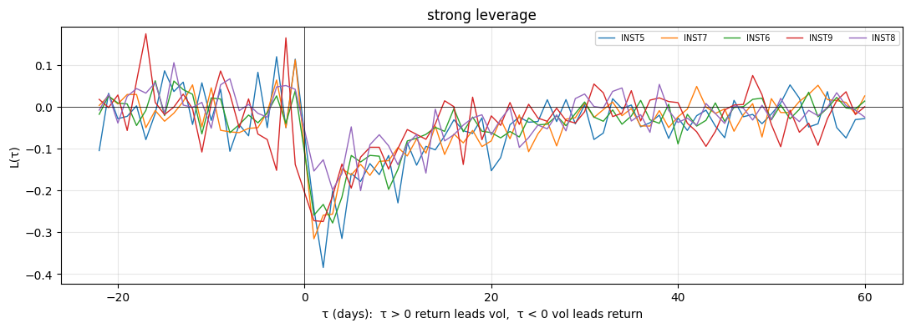
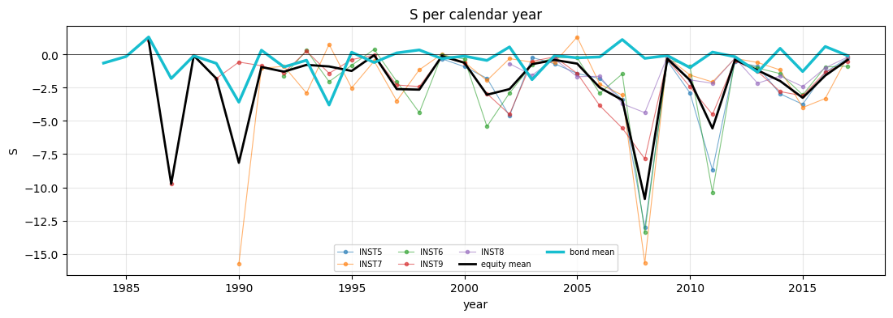
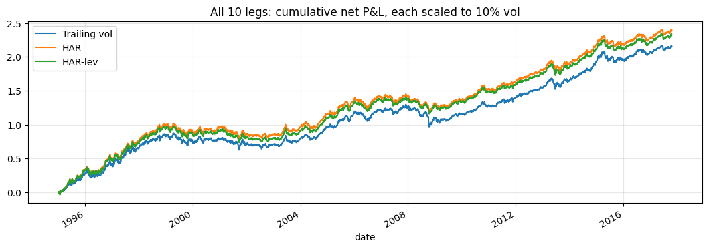
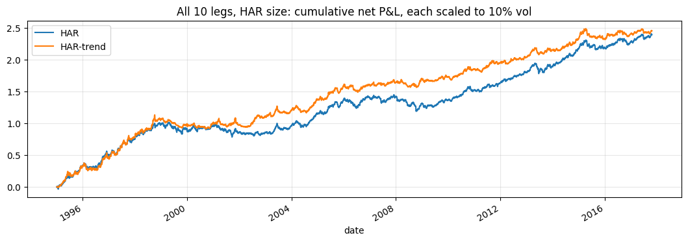

# Leverage Effect in Futures

Measuring, testing and trading the leverage effect (falling prices raise future volatility) across 5 equity-index and 5 government-bond futures.

**[▶ Live demo](https://jolikewe.github.io/leverage_effect/)**: the study as an interactive, scroll-driven story.


## Overview

The dataset holds daily returns of 10 anonymised futures contracts (`INST0`-`INST9`, 1982 to 2017); the asset class of each is not given. The study asks five questions:

1. **Measurement:** which instruments show a leverage effect, using the leverage correlation function of Bouchaud, Matacz & Potters (2001) on vol-normalised returns? This also identifies the equity indices.
2. **Significance and stability:** is the effect distinguishable from chance (sign-flip surrogates, Bonferroni correction) and is it stable across calendar years?
3. **Direction:** do returns predict volatility, or volatility predict returns? Tested with HAR and HAR-with-leverage regressions.
4. **Cross-category spillover:** do equity moves affect bond volatility, or the reverse?
5. **Strategy:** a volatility-targeted long book sized with HAR / HAR-lev forecasts, with a time-series trend overlay, compared on Sharpe, QLIKE and a Diebold-Mariano test.

## Results

**Q1-Q2: leverage effect per instrument.** `S` is the cumulative leverage correlation over the next 22 days; `z` and `p` come from 1000 sign-flip surrogates (p-value floor is 1/1001).

| Instrument | Class (inferred) | S | z | p |
|---|---|---|---|---|
| INST5 | Equity | -3.118 | -5.02 | 0.001 |
| INST7 | Equity | -2.760 | -5.87 | 0.001 |
| INST6 | Equity | -2.491 | -6.34 | 0.001 |
| INST9 | Equity | -2.131 | -5.10 | 0.001 |
| INST8 | Equity | -1.935 | -5.66 | 0.001 |
| INST2 | Bond | -1.292 | -3.54 | 0.001 |
| INST4 | Bond | -0.447 | -2.41 | 0.017 |
| INST0 | Bond | -0.409 | -1.86 | 0.062 |
| INST3 | Bond | -0.306 | -1.60 | 0.118 |
| INST1 | Bond | -0.216 | -1.21 | 0.227 |

All five equity indices reject the null of no leverage effect (Bonferroni threshold |z| > 2.8) and have S < 0 in 89-100% of calendar years. Bonds show no stable effect; INST2 is the exception, reacting like an equity index but fading in about 6 days instead of 8-14.





**Q3: direction.** For all five equity indices the return coefficient on next-week variance is negative (gamma from -0.251 to -0.145, p < 1e-4) after controlling for past variance, with and without the 1987 and 2008 crisis windows. Past volatility does not predict returns, apart from INST9.

**Q4: cross-category.** Equity falls raise next-week bond variance slightly (basket theta = -0.054, p = 0.018; R-squared 0.155 to 0.161). Bond returns do not predict equity volatility (basket p = 0.56).

**Q5: strategy** (walk-forward, 1995-2017, 10% vol target, net of costs; ALL = 5 equity + 5 bond legs).

| Strategy | Book | Ann. return % | Ann. vol % | Sharpe | Max DD % |
|---|---|---|---|---|---|
| Trailing vol | EQ | 1.58 | 7.74 | 0.205 | -44.5 |
| HAR | EQ | 1.50 | 6.62 | 0.227 | -43.0 |
| HAR-lev | EQ | 1.27 | 6.69 | 0.190 | -44.7 |
| HAR-trend | EQ | 1.43 | 4.00 | 0.357 | -13.1 |
| Trailing vol | BD | 6.35 | 7.40 | 0.859 | -19.3 |
| HAR | BD | 6.62 | 7.14 | 0.926 | -20.0 |
| HAR-trend | BD | 4.85 | 5.32 | 0.911 | -11.6 |
| Trailing vol | ALL | 4.14 | 4.52 | 0.916 | -14.9 |
| HAR | ALL | 4.28 | 4.20 | 1.018 | -11.0 |
| HAR-lev | ALL | 4.18 | 4.23 | 0.990 | -10.6 |
| HAR-trend | ALL | 3.30 | 3.17 | 1.044 | -6.9 |

Forecast accuracy (QLIKE, lower is better) improves from trailing vol to HAR (equities 0.518 to 0.397, bonds 0.400 to 0.342; Diebold-Mariano p < 1e-10) and again with leverage terms for equities (HAR-lev 0.385, p = 1.1e-8). Better forecasts do not translate into significantly better P&L: HAR vs trailing vol on ALL Sharpe has bootstrap p = 0.055, HAR-lev scores below HAR (p = 0.030), and HAR-trend vs HAR has p = 0.86. Most of the Sharpe comes from bonds and the negative equity-bond correlation (-0.26).





## Repository structure

```
.
├── notebooks/
│   └── leverage_effect.ipynb   # full study with stored outputs
├── data/                       # INST0-INST9.csv: daily returns, columns date,return, no header
├── docs/
│   └── NOTES.md                # methodology notes and design choices
├── assets/                     # figures extracted from the notebook outputs
├── requirements.txt
└── README.md
```

## Getting started

Requires Python 3.11.

```bash
python -m venv .venv
source .venv/bin/activate
pip install -r requirements.txt
jupyter lab notebooks/leverage_effect.ipynb
```

The notebook reads the data via the relative path `../data/`, which resolves correctly when Jupyter opens it from `notebooks/`. Stored outputs are included, so it can be read without re-running.

## Method

- **Normalisation:** returns are divided by the lagged 252-day rolling volatility, so instruments at different vol levels are comparable.
- **Leverage correlation:** L(tau) = cov(x_t, x_{t+tau}^2) / <x^2>^2; S sums it over tau = 1..22. Significance comes from 1000 surrogate series with random signs and unchanged magnitudes.
- **Direction:** next-5-day variance regressed on daily, weekly and monthly realised variance (HAR) plus the return and its absolute value, with Newey-West standard errors; the reverse regression tests vol to returns.
- **Strategy:** position sizes from the forecast variance toward a 10% vol target with a 20% rebalancing band, trades at the next close, half-spread costs of 1bp (equities) and 0.5bp (bonds). Trend votes use 1, 3 and 12-month lookbacks. Sharpe differences use a 21-day block bootstrap; forecast differences use Diebold-Mariano with Newey-West errors.

See `docs/NOTES.md` for the reasoning behind each choice.

## References

- Bouchaud, Matacz & Potters (2001), Leverage effect in financial markets: the retarded volatility model.
- Corsi & Reno (2012), Discrete-time volatility forecasting with persistent leverage effect.
- Patton (2011), Volatility forecast comparison using imperfect volatility proxies.
